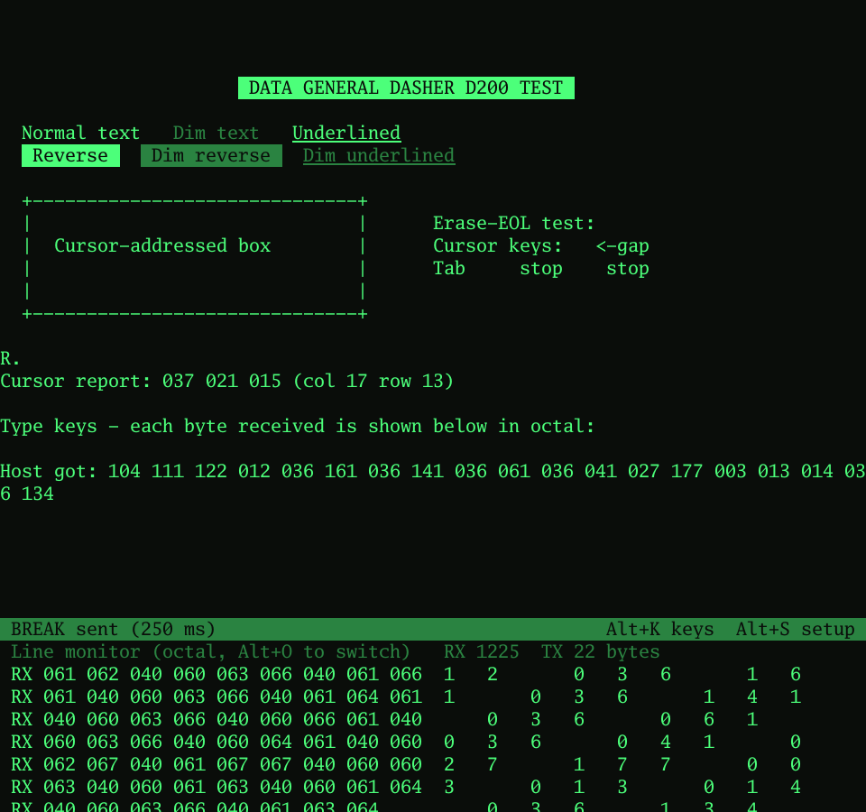

# Dasher D200 — terminal emulator for Data General Nova and Eclipse

A Data General Dasher D200 terminal emulator for macOS, Windows, Linux and
the Raspberry Pi. It connects to real DG hardware over a serial line, to
other computers by telnet or SSH, or runs a local program - such as a DG
computer emulator running AOS/VS or RDOS - inside the D200 window.

- Faithful D200 screen handling: 24 × 80, cursor addressing, erase
  commands, blink / dim / underline / reverse, roll enable/disable, and
  the D200's function keys (F1–F15, C1–C4 with Shift and Ctrl).
- Serial with every setting a Nova or Eclipse console might need,
  including a true BREAK for the Eclipse virtual console.
- Telnet, SSH, and running local programs, so it works just as well with
  a DG emulator as with real hardware.
- A line monitor showing every byte in octal or hex with its D200 meaning.
- Up-arrow recall of the last 10 lines typed, clickable web links, copy
  and paste, saved connection profiles, and green, white or amber phosphor.

Version 0.2.8.

## Download

Get the latest files from the
[Releases page](https://github.com/bamchchnz/dasher200/releases):

| Platform | Download | Inside |
|---|---|---|
| macOS 12 or later (Apple Silicon and Intel) | `Dasher-D200-macOS.zip` | `Dasher D200.app` (universal), `Sign Dasher D200.command` |
| Windows 10/11 (Intel/AMD) | `Dasher-D200-Windows.zip` | `Dasher200-x64.exe` - single file, no installer |
| Windows 11 on ARM | `Dasher-D200-Windows.zip` | `Dasher200-arm64.exe` |
| Raspberry Pi, 64-bit OS (Pi 3/4/5) | `Dasher-D200-RaspberryPi.tar.gz` | `dasher200-arm64` |
| Raspberry Pi, 32-bit OS | `Dasher-D200-RaspberryPi.tar.gz` | `dasher200-armhf` |
| Linux x86-64 | `Dasher-D200-Linux.tar.gz` | `dasher200` (desktop Linux with X11 or Wayland) |

Or build it yourself - see [Building from source](#building-from-source).

## The downloads are not signed

The programs aren't signed with an Apple Developer ID or a Windows
code-signing certificate (both cost money every year), so your computer
will be wary of them at first. That's expected; here is what to do.

**Checking a download.** Each release lists SHA-256 checksums
(`SHA256SUMS.txt`). Compare: `shasum -a 256 file` (Mac),
`sha256sum file` (Linux), `certutil -hashfile file SHA256` (Windows). The
builds are reproducible, so you can also build from the source and compare.

### macOS: first launch

macOS blocks an unsigned app the first time. Double-click it once (it
will be refused), then open **System Settings → Privacy & Security**,
scroll down to the message about Dasher D200 and click **Open Anyway**.
You only need to do this once.

### macOS: sign it yourself with a free certificate (recommended)

Without a signature, macOS recognises the app by a fingerprint of the
program, which changes with every new version. Permissions you've given
it - in particular **Local Network** access, needed for telnet and SSH to
computers on your home network - can then quietly stop applying after an
update. Signing the app with a certificate of your own fixes that, and
costs nothing:

1. **Create a code-signing certificate (once).** Open **Keychain Access**
   (in Applications → Utilities) and choose **Keychain Access →
   Certificate Assistant → Create a Certificate…** from the menu bar.
   - Name: `Dasher D200 Local`
   - Identity Type: **Self-Signed Root**
   - Certificate Type: **Code Signing**

   Click **Create**, then **Done**. It's valid for a year.
2. **Sign the app** after installing it, and again after each update. In
   Terminal, type `bash ` (with a space), drag **Sign Dasher D200.command**
   from the download into the window and press Return - or run the
   command it uses yourself:

       codesign --force --deep -s "Dasher D200 Local" "/Applications/Dasher D200.app"

   If macOS asks whether codesign may use your key, click **Always Allow**.
3. **First time only:** open D200 from Finder and click **Allow** when it
   asks about the local network. If it doesn't ask and local addresses
   don't work, switch Dasher D200 off and on under **System Settings →
   Privacy & Security → Local Network**.

From then on macOS knows the app by your certificate, so a newly signed
version keeps its permissions. When the certificate expires, create a new
one with the same name, sign the app again and repeat step 3.

### Windows

SmartScreen may say Windows protected your PC: choose **More info → Run
anyway**. Windows Defender has also been known to flag unsigned Go
programs with a machine-learning guess such as `Trojan:Win32/Bearfoos.A!ml`
or `Wacatac!ml` - the `!ml` means it's a guess, not a known virus. If that
happens, check the file against `SHA256SUMS.txt`, restore it from
**Windows Security → Protection history**, and if you like report it to
Microsoft as a false positive at
<https://www.microsoft.com/wdsi/filesubmission>.

### Linux and Raspberry Pi

Nothing to sign; just make the file executable (`chmod +x`).

## Platform notes

### macOS: Local Network permission (telnet and SSH)

macOS 15 and later must allow an app to reach computers on your home
network. The first time D200 connects, macOS should ask - click **Allow**.
You can check it under **System Settings → Privacy & Security → Local
Network**. If a connection to a local computer fails with "Undefined
error: 0" or "no route to host", the permission isn't in effect: sign the
app as above, or as a quick workaround start D200 from Terminal
(`"/Applications/Dasher D200.app/Contents/MacOS/dasher200" &`), since
Terminal already has the permission. Addresses on a Tailscale network
(100.x.x.x) don't count as local network. The same applies to programs
run with the Local program connection (e.g. `ping` to a local address).

### macOS: "uses Rosetta" / Intel code warning

D200 itself is a universal app with native Apple Silicon code. If macOS
warns that Dasher D200 "contains code that will not be supported" or is
using Rosetta, it's coming from an Intel-only program that D200 is
running for you as a Local program - most often an `ssh` or emulator
installed by an old Intel copy of Homebrew in `/usr/local`. Check with
`file /usr/local/bin/ssh` (an Apple Silicon program says `arm64`). Installing
Apple Silicon Homebrew (in `/opt/homebrew`) and reinstalling the program
there fixes it.

### Raspberry Pi

Check which build you need:

    dpkg --print-architecture      # arm64 -> dasher200-arm64, armhf -> dasher200-armhf

Then make it executable and run it from the Pi's desktop (not over plain SSH):

    chmod +x dasher200-arm64
    ./dasher200-arm64

On a Pi with older VC4 graphics (OpenGL ES 2.0 only, as on the Pi 3),
D200 switches itself to software rendering, which is plenty for a
terminal screen. It also retries that way if the graphics fail to start
for any other reason (the error mentions `glfw` or `egl`). To force it
yourself: `LIBGL_ALWAYS_SOFTWARE=1 ./dasher200-arm64`.

To open the USB-serial adapter your user must be in the `dialout` group
(`groups` shows it). If not: `sudo usermod -aG dialout $USER`, then log
out and back in. The adapter normally appears as `/dev/ttyUSB0`.

## Connection types

Choose **Connection** on the setup screen (Alt/Option+S):

| Connection | Use it for | Settings |
|---|---|---|
| **Serial** | Real Nova/Eclipse hardware through a USB-serial adapter | Port, baud, data bits, parity, stop bits, flow control, Mode |
| **Telnet** | A DG emulator's telnet console (SimH, mvemu…) or any telnet host | Host, Port (default 23) |
| **SSH** | Any computer running an SSH server | Host, Port (default 22), User |
| **Local program** | Running a DG computer emulator (or any program) inside the D200 window | Command, Start in folder |

Text fields (Host, Port, User, Command, folder) are shown in square
brackets: select one, press **Right** (or Space) to edit, type, then
**Enter** when done. Press **Enter** again to connect.

**Local program** runs the command exactly as you'd type it at the
command line, in a proper terminal (a pseudo-terminal) sized 80×24, with
`TERM=d200`. Everything the program prints goes through the D200
emulation, and every key you press - function keys, Ctrl keys, cursor
keys - goes straight to it. Ctrl+C, Ctrl+\ and Ctrl+Z reach the program
normally, even if the emulator itself was started from a script. When the
program exits, the status bar shows "program exited". Use the program's own key to get its attention (for
example Ctrl+E in SimH); the BREAK key doesn't apply to a local program.
On macOS the command runs in a login shell, so it finds the same programs
as Terminal does (for example Homebrew's `ssh`, which is needed for a
YubiKey or other FIDO security key; Apple's own `ssh` can't use one and
just reports "Permission denied (publickey)").
On Windows, programs run with plain input/output pipes rather than a
pseudo-terminal, so for an emulator on Windows its telnet console is the
more reliable route. To SSH from a Local program on Windows, D200 adds
`-tt` to an `ssh` command automatically, so the remote computer still
gets a proper terminal (otherwise ssh reports "Pseudo-terminal will not
be allocated because stdin is not a terminal"). Windows' ssh logs in with your
Windows user name unless told otherwise, so give the name in the command
(`ssh user@pi`) or add a `Host` block with a `User` line to
`C:\Users\<you>\.ssh\config`.

**Telnet** handles the usual option negotiation, reports the terminal
type as D200 if the host asks, and Alt/Option+B sends a telnet BREAK.

**SSH** logs in with your SSH agent or keys in `~/.ssh` (id_ed25519,
id_ecdsa, id_rsa) if they're accepted, and otherwise asks for your
password in a box on screen. It doesn't read `~/.ssh/config` and can't
use security keys such as a YubiKey; for those, use **Local program**
with the command `ssh yourhost` - your system's own ssh then handles the
key, the touch prompt and your config. If the login is refused, the setup
screen says which to use. The first time you connect to a computer it
shows the host's key fingerprint and asks you to type **yes** to trust
it; it's then remembered in `~/.ssh/known_hosts` - the same file your
system's ssh uses (on Windows, `C:\Users\<you>\.ssh\known_hosts`), and
whichever key type is already recorded there for a host is the one asked
for. If a known host's key ever changes, the connection is refused and
the message says which line of the file to delete (or run
`ssh-keygen -R hostname`) if the change is expected, for example after
reinstalling the computer. Alt/Option+B sends an SSH BREAK.
The terminal type sent is `d200` (change it under the advanced settings,
press **A**).

Modern Linux and macOS hosts sometimes send ANSI escape sequences that a
real D200 wouldn't understand; the emulator quietly discards them rather
than printing junk. If a program sets the window title this way - some DG
emulators show their status, e.g. "MV/8000 … MIPS: 40.2" - it appears in
the D200 window's title bar instead.

Save each set-up as a named profile (**N**), e.g. "Nova console",
"Eclipse emulator", "Pi over SSH".

## Getting connected (serial)

1. Plug in your USB-serial adapter and start the app. It opens on the
   **Setup** screen.
2. Use **Up/Down** to choose a setting and **Left/Right** to change it.
   On a Mac, choose the `/dev/cu.…` device, not `/dev/tty.…` (the tty
   device waits for carrier detect before it will open).
3. Press **Enter** to connect. If the port won't open, the error is shown
   on the setup screen.
4. Press **N** to save the settings as a named profile (for example
   "Nova console" or "Eclipse S/140"): type the name and press
   **Enter** (Esc cancels). To use a profile, select the Profile line and
   press **Left/Right** to choose it, then **Enter** to connect. To change
   one, choose it, change the settings, press **N** and Enter to keep the
   same name. **Del** deletes the profile shown. The last settings used
   are remembered automatically.

Settings on the setup screen: **Mode**, serial port, baud rate
(110–38400), 7 or 8 data bits, parity (none/even/odd/mark/space), 1 or 2
stop bits, flow control (none/XON-XOFF/RTS-CTS) and phosphor colour
(green/white/amber).

**Mode** sets the keyboard behaviour in one step:

| Mode | Use it for | What it does |
|---|---|---|
| Connected to computer (default) | Real Nova/Eclipse hardware | Enter sends NL (012), Backspace sends RUBOUT (177); the host does any erasing, as with a real D200 |
| Loopback test | A loopback plug, no computer attached | Same keys, but a returned RUBOUT erases the previous character on screen, so typing and deleting look normal. The status bar shows **[LOOPBACK]** |

**Advanced settings** (press **A** on the setup screen) let you change
the individual pieces if a host needs something different: what Enter
sends (NL or CR), what Backspace sends (DEL, BS or cursor-left), how a
received DEL is shown, local echo, and stripping the 8th bit. If you
change any of these, Mode shows *Custom*. Choosing a Mode again resets
them.

- NL (012) is the Dasher NEW LINE key — it moves to the start of the next
  line. CR (015) only returns to column 0 of the same line. DG systems
  expect NL; a modern Unix host usually wants CR.
- BS (010) suits some modern hosts, but on a D200 010 means HOME, so a
  host that echoes it sends the cursor to the top of the screen.

### Electrical level: check before you blame the software

The original Nova teletype interface is very likely **20 mA current
loop**, not RS-232. A USB-serial adapter alone will not talk to it — you
need a current-loop-to-RS-232 converter. Later DG multiplexer boards and
Eclipse console ports are generally RS-232. If you see nothing at all,
check this first; if you see garbage, check baud/parity.

## The keyboard

| D200 key | Press |
|---|---|
| F1–F12 | F1–F12 (Shift, Ctrl and Ctrl+Shift work as on a D200) |
| F13–F15 | F13–F15, or Option/Alt + F1–F3 |
| C1–C4 | Option/Alt + F5–F8 (add Shift for shifted C keys) |
| NEW LINE (012) | Enter (can be changed to CR in setup) |
| Cursor keys, HOME | Left/Right arrows, Home; Up/Down with Shift held (see below) |
| ERASE EOL / ERASE PAGE | End / Page Down |
| RUBOUT (177) | Backspace (the Mac **delete** key) or forward Delete |
| Control characters | Ctrl + letter |

On a Mac the F-keys may need **fn** held, or turn on *Use F1, F2, etc.
keys as standard function keys* in System Settings → Keyboard.

### Mouse: links, copy and paste

- **Web addresses** on the screen (http:// or https://) can be clicked:
  the pointer turns into a hand over one, and a click opens it in your
  browser - handy for a login link such as Tailscale's. An address that
  runs onto the next line is followed.
- **Copy:** drag over text to select it; it's copied to the clipboard when
  you let go. Cmd+C (Mac) or Ctrl+Shift+C copies the selection again.
- **Paste:** right-click, or Cmd+V (Mac) / Ctrl+Shift+V (Windows, Linux).
  The text is sent to the host as if typed; line breaks are sent as the
  Enter key. Plain Ctrl+C and Ctrl+V still go to the host as control
  characters.
- On Linux the clipboard needs `wl-clipboard` (Wayland) or `xclip` (X11):
  `sudo apt install xclip`.

### Recalling earlier lines (Up / Down)

**Up** brings back the last line you typed; press it again for the one
before, through the last 10 lines, then round to the newest again.
**Down** goes forward, and past the newest returns to whatever you had
started typing. The recalled line is typed for you (after erasing the
current line with RUBOUT), so you can edit it or just press **Enter**.
It works with any host that edits lines with RUBOUT - the AOS/VS CLI,
RDOS, a Unix shell.

- A line is only remembered if the host echoed it, so a password typed
  at a prompt that hides it isn't kept. Lines are kept in memory only,
  never saved to disk.
- If you use Tab, Esc, cursor or function keys on a line, the emulator
  can't be sure what the host's line contains, so that line isn't kept.
- **Shift+Up / Shift+Down** still send the D200 cursor up/down codes. For
  full-screen programs that use cursor keys a lot (a screen editor, say),
  set **Up/Down arrows** to *D200 cursor up/down* on the setup screen;
  that's saved with the profile.

### Local commands (Option on a Mac, Alt on Windows/Linux)

| Keys | Action |
|---|---|
| Alt+B | Send a true serial **BREAK** (250 ms) |
| Alt+S | Setup screen |
| Alt+R / Alt+D | Reconnect / disconnect |
| Alt+H | Show/hide the line monitor |
| Alt+O | Line monitor in octal or hex |
| Alt+E | Local echo on/off |
| Alt+C | Clear the screen |
| Alt+P | Cycle phosphor colour |
| Alt+K | Keyboard help |
| Alt+Q | Quit |

**BREAK** holds the line in the spacing state, which is what an Eclipse
with the virtual console needs to halt the CPU and drop into the
virtual console. It is a real line condition, not a character.

## Line monitor

**Alt+H** opens a panel below the screen showing every byte in both
directions — RX from the host, TX from the keyboard (shown dimmer) — in
octal (or hex), with the D200 meaning of each control code (WWA = write
window address, EOL = erase to end of line, CMD = 036 command prefix,
and so on). Use it to tell "wrong line settings" (garbage values) apart
from "wrong control code" (sensible values the emulator doesn't act on).

## What is emulated

- 24 × 80 screen; characters 040–176.
- Cursor control: home (010), new line (012), carriage return (015),
  tab (011), cursor up/down/left/right (027/032/031/030) with D200
  wrap-around, write window address (020 col row, 0177 = unchanged).
- Erase to end of line (013), erase page (014).
- Attributes: blink (016/017, with 003/004 blink enable/disable), dim
  (034/035), underline (024/025), reverse video (036 D / 036 E).
- Roll enable/disable (022/023): with roll disabled the cursor wraps to
  the top line instead of scrolling.
- Host queries: read cursor address (005 → 037 col row) and read model
  ID (036 C).
- Bell (007) as a visual flash.
- D210/D211-only extended commands (036 F …) are recognised and skipped
  so they don't print as garbage.

### Known limitations

- **Model ID reply.** The exact bytes a real D200 returns for 036 C are a
  best guess. If a DG program misidentifies the terminal, the line
  monitor will show the query and reply, and it's a one-line change.
- **XON/XOFF.** On a Dasher, 021 and 023 are also "print screen" and
  "roll disable". With XON/XOFF selected those two codes are consumed as
  flow control, so roll-disable from the host will be lost. Use "none"
  (usual for a console) or RTS/CTS if the host supports it.
- **RTS/CTS** is done by checking CTS before each byte, which is plenty
  for keyboard input.
- **Mark/space parity with 7 data bits** is emulated (8 bits on the wire
  with the top bit forced), which works on every platform. macOS cannot
  do mark/space parity with 8 data bits.
- No printer port and no audible bell.

## Command-line options

    dasher200 -list                       # list serial ports
    dasher200 -profile "Nova console"     # connect with a saved profile
    dasher200 -port /dev/cu.usbserial-A1 -baud 9600 -databits 7 -parity even
    dasher200 -monitor                    # start with the line monitor open
    dasher200 -telnet localhost:2323      # telnet to a host (port optional)
    dasher200 -ssh brendan@nova-pi        # SSH (user@host or user@host:port)
    dasher200 -run "./mvemu"              # run a local program in the terminal

Settings are stored in `~/Library/Application Support/Dasher200/` (Mac),
`%AppData%\Dasher200\` (Windows) or `~/.config/Dasher200/` (Linux).

## Building from source

Requires [Go](https://go.dev/dl/) 1.25 or later - nothing else, not even a
C compiler. The libraries it uses are included in `vendor/`, so it builds
offline:

    git clone https://github.com/bamchchnz/dasher200.git
    cd dasher200
    go build -o dasher200 .        # dasher200.exe on Windows
    go test ./dasher ./link

Every platform cross-compiles from any other, e.g. for a Raspberry Pi:
`GOOS=linux GOARCH=arm64 CGO_ENABLED=0 go build`. To make all the release
downloads at once, run `sh build.sh` (it needs `zip`, and `lipo` or
`llvm-lipo` for the universal Mac app); they appear in `dist/`. GitHub
Actions runs the same script on every push.

The Windows builds use `-trimpath -ldflags="-H windowsgui"` and are
reproducible: the same source and Go version give a byte-identical
`.exe`, so you can check a download against your own build. The
`rsrc_windows_*.syso` files hold the icon, version details and manifest;
they're made from `winres/` with `sh build.sh winres`.

Source layout: `dasher/` is the D200 screen model, control-code decoder
and keyboard encoding (with unit tests); `link/` holds the serial,
telnet, SSH and local-program connections;
`ui.go` and `setup.go` are the window, setup screen and line monitor;
`testhost/fakehost.py` is a fake DG host for testing over a virtual
serial pair (`socat`), and `testhost/telnethost.py` a test telnet server.

## Licence

MIT - see [LICENSE](LICENSE). The libraries in `vendor/` (Ebitengine,
go.bug.st/serial, golang.org/x/crypto, creack/pty and their dependencies)
keep their own licences, included alongside them.

Data General, Nova, Eclipse, Dasher, AOS/VS and RDOS are trademarks of
their respective owners. This is an independent hobby project with no
connection to Data General.
